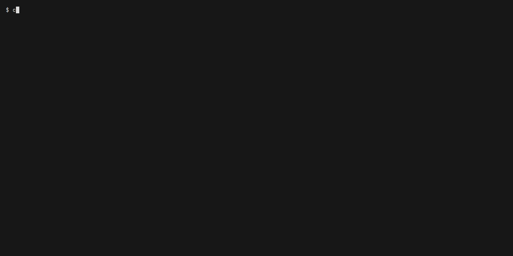

# claude-dashboard

**k9s-style TUI for managing Claude Code sessions with real-time monitoring, conversation history, and process-based session detection.**

[](https://opensource.org/licenses/MIT)
[](https://github.com/seunggabi/claude-dashboard/stargazers)
[](https://github.com/seunggabi/claude-dashboard/actions/workflows/ci.yml)
[](https://go.dev)
[](https://github.com/seunggabi/claude-dashboard/releases)
[](https://github.com/tmux/tmux)

---

## Demo

<p align="center"></p>

<sub>Recorded with [VHS](https://github.com/charmbracelet/vhs) from [`demo/demo.tape`](demo/demo.tape). The sessions in the recording run a stub in place of `claude`.</sub>

## Quick Start

### Homebrew

```bash
brew install seunggabi/tap/claude-dashboard
```

### Install script

```bash
curl -fsSL https://raw.githubusercontent.com/seunggabi/claude-dashboard/main/install.sh | bash
```

This installs the binary to `~/.local/bin`. To install it under a different name:

```bash
curl -fsSL https://raw.githubusercontent.com/seunggabi/claude-dashboard/main/install.sh | bash -s -- --name <your-binary-name>
```

### Go

```bash
go install github.com/seunggabi/claude-dashboard/cmd/claude-dashboard@latest
```

### From source

```bash
git clone https://github.com/seunggabi/claude-dashboard.git
cd claude-dashboard
make install
```

### First run

```bash
claude-dashboard   # Launch the TUI dashboard
```

The first run performs a one-time setup. You can repeat it at any time with `claude-dashboard setup`. Setup:

- installs three helper scripts to `~/.local/bin/`
- appends a `claude-dashboard` block to `~/.tmux.conf`: `F12` mouse toggle, `Ctrl+S` history save, a status bar with version info, mouse mode on, and a 50,000-line scrollback

### 💡 Pro Tip: Super Fast Session Creation

Type just **`cdn`** instead of `claude-dashboard new`:

```bash
# One-line setup (adds the alias to your shell rc file)
source <(curl -fsSL https://raw.githubusercontent.com/seunggabi/claude-dashboard/main/alias.sh)
```

```bash
# Before: claude-dashboard new my-project --path ~/code/foo
# After:  cdn my-project --path ~/code/foo  ⚡️

cdn -r                                 # Resume (interactive picker)
cdn -c                                 # Continue most recent conversation
cdn my-project -r                      # Resume with session name
```

### 🔄 Upgrade

```bash
# Homebrew
brew update
brew upgrade claude-dashboard

# Install script
curl -fsSL https://raw.githubusercontent.com/seunggabi/claude-dashboard/main/install.sh | bash

# Go
go install github.com/seunggabi/claude-dashboard/cmd/claude-dashboard@latest
```

After upgrading, run setup again to apply new tmux configuration:

```bash
claude-dashboard setup
```

## Why claude-dashboard

### The Problem

Running multiple Claude Code sessions across different projects quickly becomes unmanageable:

- **Lost sessions** - Terminal closed? Session gone. What was Claude doing?
- **No overview** - Which session is active? How long has it been running? What are resource usage patterns?
- **Context switching** - Constantly hunting through terminal tabs, tmux windows, and scattered `.jsonl` logs.
- **Session discovery** - Sessions hidden in tmux, terminal tabs, or started by other tools.

### The Solution

claude-dashboard gives you a **single pane of glass** for all your Claude Code sessions:

- **Unified session detection** - Finds Claude sessions in tmux, terminal tabs, and anywhere in the process tree
- **Conversation history** - View Claude's past interactions directly from the dashboard
- **Real-time monitoring** - CPU, memory, status, and uptime at a glance
- **Session persistence** - Sessions keep running in tmux; detach anytime and come back
- **Single binary** - One `brew install` and you're done

Sessions run inside tmux - close your terminal, shut your laptop, and come back anytime. [k9s](https://k9scli.io/)-style vim navigation with real-time CPU/memory monitoring.

## Keybindings

### Dashboard

| Key       | Action                                     |
|-----------|--------------------------------------------|
| `↑` / `k` | Move cursor up                             |
| `↓` / `j` | Move cursor down                           |
| `enter`   | Attach to session                          |
| `n`       | Create new session                         |
| `K`       | Kill session (with confirmation)           |
| `Ctrl+K`  | Kill all idle sessions (with confirmation) |
| `l`       | View session logs                          |
| `d`       | Session detail view                        |
| `/`       | Filter / search sessions                   |
| `r`       | Manual refresh                             |
| `?`       | Help overlay                               |
| `esc`     | Go back / cancel                           |
| `q`       | Quit                                       |

### Detail View

| Key   | Action                           |
|-------|----------------------------------|
| `l`   | View session logs                |
| `K`   | Kill session (with confirmation) |
| `esc` | Back to dashboard                |
| `q`   | Quit                             |

### Logs Viewer

| Key             | Action            |
|-----------------|-------------------|
| `↑` / `k`       | Scroll up         |
| `↓` / `j`       | Scroll down       |
| `PgUp` / `PgDn` | Page up / down (macOS: `Fn+↑` / `Fn+↓`) |
| `esc`           | Back to dashboard |
| `q`             | Quit              |

### Inside an Attached Session

These are tmux bindings added by `claude-dashboard setup`, plus the tmux defaults they build on.

| Key        | Action                                                    |
|------------|-----------------------------------------------------------|
| `Ctrl+B d` | Detach and return to the dashboard                        |
| `Ctrl+S`   | Save the entire pane history to a file in `~/Desktop/`    |
| `F12`      | Toggle mouse mode (ON: scroll with mouse, OFF: easy text select) |
| `Ctrl+B [` | Scroll history in copy mode, `q` to exit                  |

To copy text while mouse mode is on, hold `Option (⌥)` (macOS) or `Shift` (Linux) while dragging.

## Features

- **Session Dashboard** - All Claude sessions in one table with real-time status, CPU/memory, and uptime (auto-refreshes every 2s).
- **Session Detection** - Lists tmux sessions created by claude-dashboard, any other tmux session with `claude` in its process tree, and Claude processes running in plain terminal tabs.
- **Log Viewer** (`l`) - For tmux sessions, the pane scrollback. For terminal sessions, the conversation history from the `.jsonl` files in `~/.claude/projects/`.
- **Attach / Detach** (`enter` / `Ctrl+B d`) - Attach to tmux sessions and return to the dashboard on detach. Terminal sessions are read-only: they can be viewed but not attached or killed.
- **Session Colors** - Each session gets a color derived from its name, shown as a marker at the start of its row. When you attach from claude-dashboard, the session name in the tmux status bar (`status-left`) uses the same color. The option is set on that session only.

### Create Session

**TUI**: Press `n` to create interactively. **CLI**:

```bash
claude-dashboard new                   # Auto-name from current directory
claude-dashboard new my-project        # Explicit name
claude-dashboard new --path ~/project  # Specify directory
claude-dashboard new --args "--model opus"
```

Session names may contain letters, digits, `_` and `-`. A name derived from a directory has every other character replaced with `-`, so `~/code/my.app` becomes `code-my-app`.

If a session with the same name already exists, `new` attaches to it instead.

#### Claude CLI Pass-through Options

Flags other than `--path` and `--args` are forwarded to `claude`:

| Flag | Description |
|------|-------------|
| `-r`, `--resume` | Resume a conversation by session ID, or open interactive picker |
| `-c`, `--continue` | Continue the most recent conversation in the current directory |
| `--model <model>` | Specify model (e.g., `opus`, `sonnet`) |

```bash
claude-dashboard new my-project -c
claude-dashboard new my-project --path ~/code/foo -r
```

## Status Detection

| Status | Indicator | Detected when |
|--------|-----------|---------------|
| `● active` | Green | The tmux session produced output in the last 2 seconds |
| `◎ waiting` | Amber | One of the last 20 pane lines ends with `?` or contains a `y/n` prompt |
| `○ idle` | Gray | Neither of the above |
| `⊘ terminal` | Blue | Claude is running in a terminal tab outside tmux (read-only) |

## Configuration

`~/.claude-dashboard/config.yaml` (optional; these are the defaults):

```yaml
refresh_interval: 2s       # Auto-refresh interval
session_prefix: "cd-"      # Prefix for sessions created by claude-dashboard
default_dir: ""            # Directory pre-filled in the new session form (default: current directory)
log_history: 1000          # Number of pane lines shown in the log viewer
```

## Usage

```bash
claude-dashboard                       # Launch TUI dashboard
claude-dashboard new [name]            # Create session (auto-name if omitted)
claude-dashboard attach <session>      # Attach directly (skip TUI)
claude-dashboard setup                 # Install helper scripts & configure tmux
claude-dashboard --version             # Show version
claude-dashboard --help                # Show help
```

## Requirements

- **tmux** (session backend)
- **macOS or Linux**
- **Go 1.24+** (only for building from source)

```bash
# macOS
brew install tmux

# Ubuntu/Debian
sudo apt install tmux
```

## Development

```bash
make build    # Build to bin/claude-dashboard
make test     # Run tests
make demo     # Re-record demo/demo.gif (requires vhs and tmux)
```

### Project Structure

```
claude-dashboard/
├── cmd/claude-dashboard/main.go      # CLI entry point and argument parsing
├── internal/
│   ├── app/app.go                    # Bubble Tea model: Update, View, key handling
│   ├── session/                      # Session management
│   │   ├── session.go                # Session data model
│   │   ├── detector.go               # Discover sessions from tmux and the process table
│   │   └── manager.go                # Create, kill, logs, filter
│   ├── tmux/                         # tmux integration
│   │   ├── client.go                 # Command wrapper
│   │   └── parser.go                 # Output parser
│   ├── conversation/reader.go        # Parse .jsonl files from ~/.claude/projects/
│   ├── monitor/                      # Resource monitoring
│   │   ├── process.go                # Process table via ps, CPU/memory aggregation
│   │   └── ticker.go                 # Periodic refresh
│   ├── setup/                        # `setup` command
│   │   ├── setup.go                  # Installs helper scripts, edits ~/.tmux.conf
│   │   └── scripts/                  # Helper scripts embedded in the binary
│   ├── ui/                           # View components
│   │   ├── dashboard.go              # Session table
│   │   ├── logs.go                   # Log viewer (viewport)
│   │   ├── detail.go                 # Detail view
│   │   ├── create.go                 # New session form
│   │   ├── help.go                   # Help overlay
│   │   └── statusbar.go              # Status bar
│   ├── config/config.go              # YAML configuration
│   └── styles/styles.go              # Lipgloss styles
├── demo/                             # VHS tape and stub for recording the demo
├── install.sh                        # Install script
├── alias.sh                          # Adds the cdn alias
├── Makefile                          # build, install, test, demo
└── .goreleaser.yml                   # Release automation
```

### Tech Stack

- [Bubble Tea](https://github.com/charmbracelet/bubbletea) - Elm architecture TUI framework
- [Bubbles](https://github.com/charmbracelet/bubbles) - TUI components (viewport, textinput)
- [Lipgloss](https://github.com/charmbracelet/lipgloss) - Style definitions
- [tmux](https://github.com/tmux/tmux) - Terminal multiplexer for session persistence

## Contributing

Contributions are welcome! Please open an issue or submit a pull request.

## Star History

[](https://star-history.com/#seunggabi/claude-dashboard&Date)

## License

[MIT](LICENSE)
